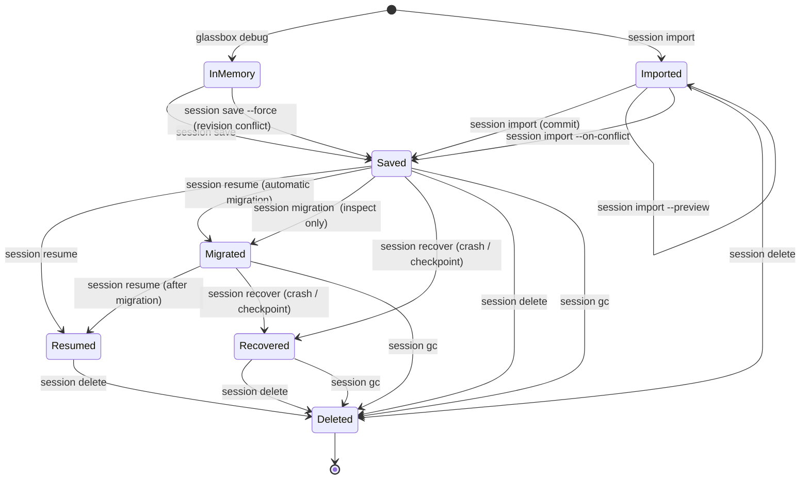

# Session Lifecycle

This guide describes how an in-memory debug result becomes a persisted session, and how sessions move between states through the `glassbox session` commands.

## State diagram

## Transitions

### User-initiated transitions

| From | To | Command | Notes |
| --- | --- | --- | --- |
| (start) | In-memory debug result | `glassbox debug <tx-hash>` | Produces an in-memory result that is not persisted until saved. |
| In-memory debug result | Saved | `glassbox session save` | Persists the debug result as a session. |
| In-memory debug result | Saved | `glassbox session save --force` | Overwrites when a revision conflict is detected. |
| Saved | Resumed | `glassbox session resume` | Loads a persisted session for continued debugging. |
| Saved | Migrated | `glassbox session resume` | Migration runs automatically on resume when the stored format is older. |
| Saved | Migrated | `glassbox session migration <id>` | Inspects migration status; this command is **read-only** and does not change the session. |
| Migrated | Resumed | `glassbox session resume` | Resume proceeds after automatic migration. |
| (start) | Imported | `glassbox session import` | Brings in an external session. |
| Imported | Saved | `glassbox session import` | Commits the imported session to storage. |
| Imported | Imported | `glassbox session import --preview` | Previews the import without committing. |
| Imported | Saved | `glassbox session import --on-conflict` | Resolves conflicts during import. |
| Saved / Resumed / Recovered / Imported | Deleted | `glassbox session delete` | Explicitly deletes a session. |

### Crash recovery and garbage collection

These transitions are distinct from normal resume and deletion:

| From | To | Command | Notes |
| --- | --- | --- | --- |
| Saved / Migrated | Recovered | `glassbox session recover` | Recovers a session after a crash or from a checkpoint. |
| Saved / Migrated / Recovered | Deleted | `glassbox session gc` | Garbage collection removes eligible sessions. |

> **Note:** `glassbox session migration <id>` is read-only and only reports migration status. Use `glassbox session gc --dry-run` to preview which sessions garbage collection would delete without removing them.

## Related commands

- `glassbox debug <tx-hash>` — create an in-memory debug result.
- `glassbox session save` — persist a debug result (`--force` for revision conflicts).
- `glassbox session resume` — resume a saved session (`--read-only` to skip migration).
- `glassbox session migration <id>` — inspect migration status (read-only).
- `glassbox session recover` — recover a session after a crash or checkpoint.
- `glassbox session import` — import a session (`--preview`, `--on-conflict`).
- `glassbox session delete` — delete a session.
- `glassbox session gc` — garbage-collect sessions (`--dry-run` to preview).